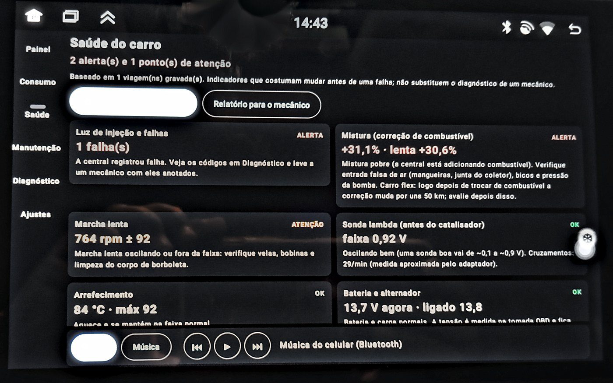
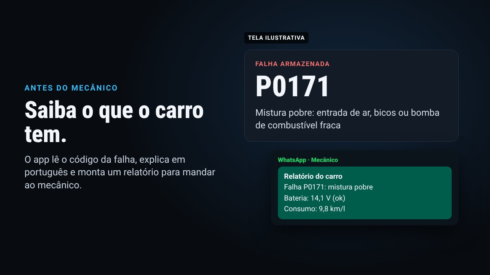
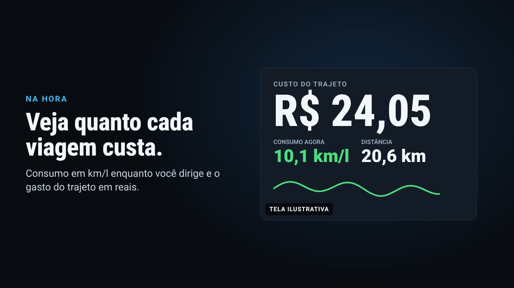
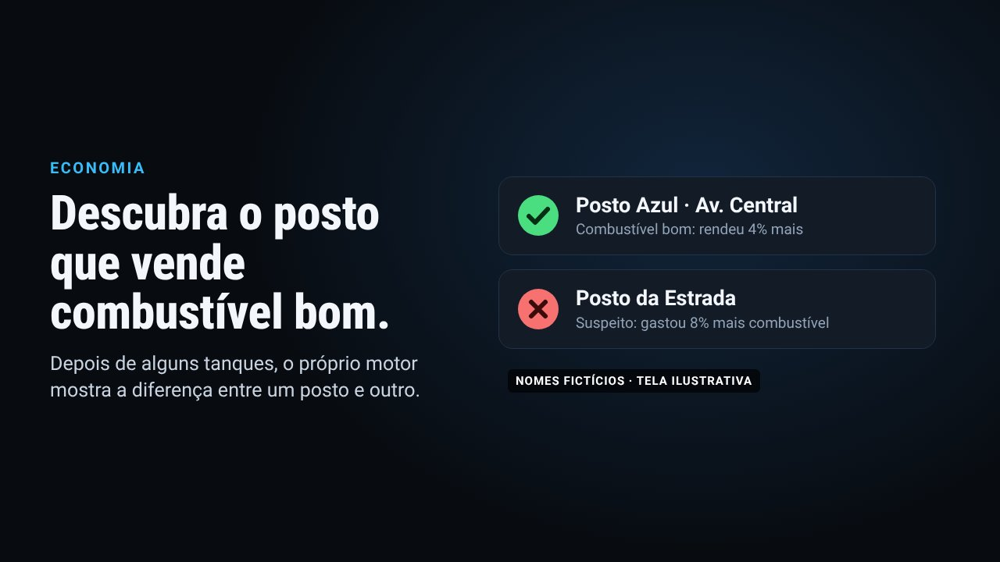
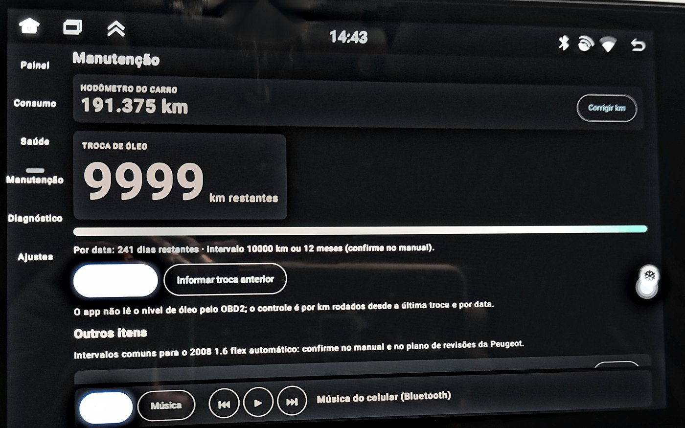
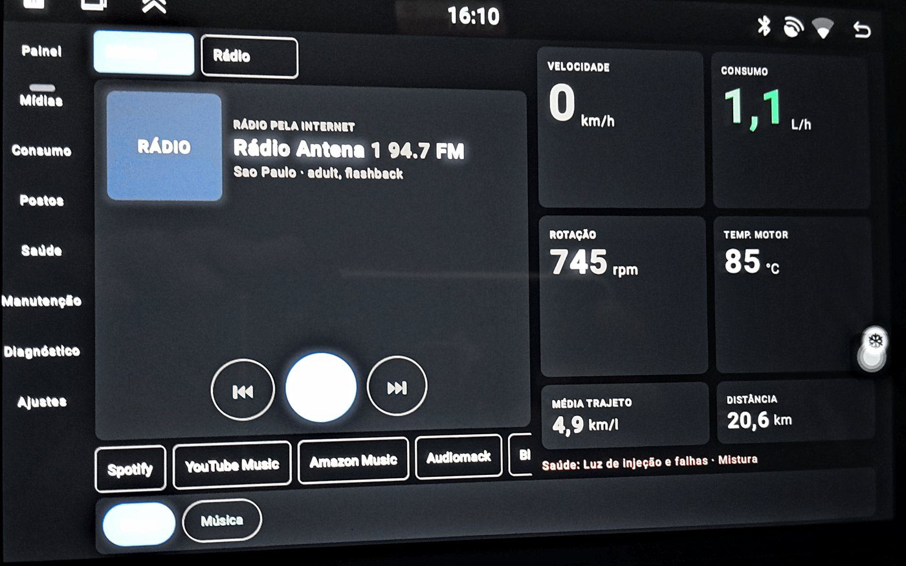

# Monitor do Carro

App Android que lê o carro por um adaptador **OBD2 ELM327** (Bluetooth clássico ou BLE) e transforma o multimídia em um painel completo: consumo em km/l, custo da viagem, rotação, temperatura, bateria, falhas da central explicadas em português, saúde do motor, manutenção e qualidade do combustível de cada posto.

Funciona no multimídia Android do carro (tela 1280x800) e no celular. Testado no carro desde outubro de 2026 em um Peugeot 2008 1.6 flex automático, com perfis também para o Citroën C4 Lounge 2.0 e o Nissan Tiida 1.8.

<p align="center">
  
  <br><sub>Foto real do app no multimídia do Peugeot 2008 (tela Saúde do carro).</sub>
</p>

## O que o app faz

| | |
|---|---|
|  | **Antes do mecânico.** Lê as falhas guardadas e pendentes (modos 03 e 07), explica cada código em português e monta um relatório para mandar pelo WhatsApp. |
|  | **Na hora.** Consumo enquanto dirige e o custo do trajeto em reais. Sem sensor de fluxo de ar (MAF), calcula pela pressão do coletor (MAP) e se calibra com os abastecimentos de tanque cheio. |
|  | **Economia.** Depois de alguns tanques, compara o que cada posto rendeu com o normal do carro e aponta combustível suspeito. |
|  | **Manutenção.** Troca de óleo e revisões por km e por data, com o hodômetro lido até de uma foto do painel (reconhecimento de texto offline). |
|  | **Mídias e mapa.** Rádio pela internet, controle da música e atalho para o mapa, com os números do carro sempre na tela ou numa janela flutuante. |

Também: comando de voz, alertas falados (motor quente, bateria fraca, reserva), estimativa do tanque, registro da tensão da bateria para provar defeito no alternador, identificação do carro pelo chassi (VIN), sincronização entre celulares pelo Firebase e integração com o Android Auto.

<p align="center"><sub>As três primeiras imagens da tabela são quadros da apresentação animada (telas ilustrativas); as duas últimas são fotos reais do app no carro.</sub></p>

## Como funciona

```
Adaptador ELM327 (tomada OBD2)
        │  Bluetooth (BLE primeiro, clássico como reserva)
        ▼
Celular ou multimídia ── MonitorEngine (leitura, cálculo, alertas)
        │                     │
        │ Wi-Fi local         └── Firebase (dados do carro entre celulares)
        ▼
Painel no multimídia (página servida pelo próprio app)
```

- **Somente leitura.** O app usa só os modos OBD 01, 03, 07 e 09 (chassi). Não escreve nada na central do carro.
- **Não inventa dados.** Pergunta ao carro quais PIDs ele suporta (0100/0120/0140/0160) e só lê o que foi declarado. A tabela do que cada carro responde está em [`docs/PIDS.md`](docs/PIDS.md).
- **Carro desligado, adaptador quieto.** Sem rotação por 5 minutos, o app para de consultar e desconecta, para não descarregar a bateria; reconecta sozinho quando o motor liga.
- **Feito para dirigir.** Botões grandes (mínimo 56 dp), alto contraste, modo direção com 4 números grandes e nada de digitação com o carro andando.

Detalhes em [`docs/ARQUITETURA.md`](docs/ARQUITETURA.md).

## Tecnologia

- Kotlin + Jetpack Compose, dois APKs (`multimidia` e `celular`)
- Bluetooth clássico (RFCOMM/SPP) e BLE para o ELM327
- Car App Library (Android Auto), Media3 (rádio), ML Kit offline (foto do hodômetro), Vosk (voz offline)
- Firebase Realtime Database e login Google para os dados do carro
- Regras de domínio puras e testadas (`android/app/src/main/kotlin/br/com/monitor2008/domain`), com mais de 200 testes unitários
- Fórmulas OBD e de consumo conferidas também em JavaScript (`tools/verify-formulas.js`) e no protótipo, com os mesmos números
- GitHub Actions compila, testa e publica o APK a cada envio

## Instalar

O APK sai pronto na página de [Releases](https://github.com/szadil763/Scanner-virtual-peugeut-2008/releases):

| Arquivo | Para |
|---|---|
| `monitor-2008.apk` | Multimídia Android do carro |
| `monitor-2008-celular.apk` | Celular |

Canais: **Teste** (`latest`, cada versão nova) e **Estável** (`estavel`, depois de testada no carro). O próprio app avisa quando há atualização. Passo a passo em [`docs/INSTALACAO.md`](docs/INSTALACAO.md).

Precisa de um adaptador ELM327 Bluetooth na tomada OBD2 (embaixo do painel). Use com o carro parado para configurar; dirigindo, só olhe o painel.

## Para desenvolver

```bash
node tools/verify-formulas.js        # confere as fórmulas OBD e de consumo
cd android && gradle test            # testes unitários
cd android && gradle assembleDebug   # gera o APK
```

O protótipo do painel (`prototype/index.html`) abre direto no navegador, com dados simulados. O app também inicia em modo simulado, sem adaptador.

```
android/      App Android (Kotlin + Jetpack Compose)
prototype/    Protótipo HTML 1280x800
tools/        Conferência das fórmulas em Node
docs/         Arquitetura, PIDs, Saúde, Postos, Voz, Android Auto, instalação
marketing/    Apresentação, vídeo de demonstração e guias
```

## Limitações

- O consumo é **estimado** (fluxo de ar, pressão do coletor ou taxa de combustível, conforme o carro responder) e se calibra com abastecimentos de tanque cheio a tanque cheio.
- Em carro flex a mistura no tanque muda o resultado; o app pergunta o combustível a cada abastecimento.
- Nível de óleo e hodômetro normalmente não saem pelo OBD2 padrão; a troca é controlada por km e data.
- A tela Saúde aponta indícios para levar ao mecânico; não substitui um diagnóstico profissional.
